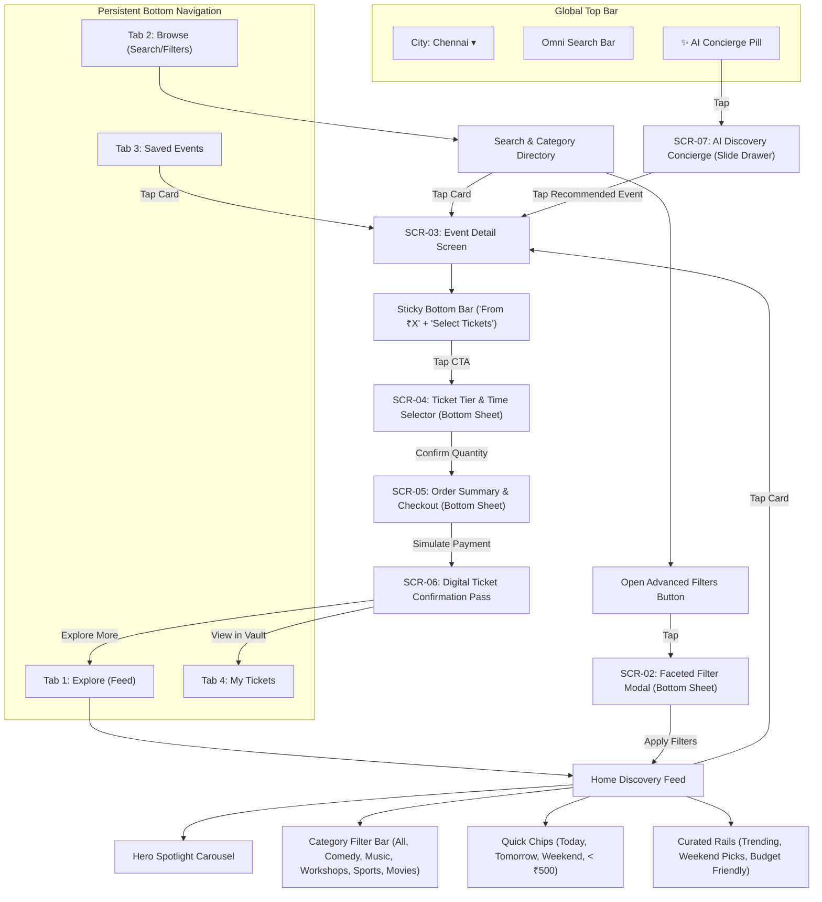
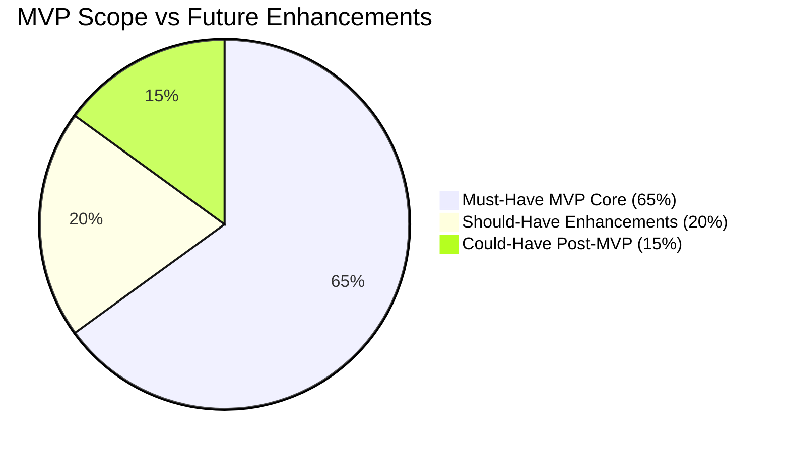

# Information Architecture and Primary User Journeys
## Multi-Category Event Discovery & Booking Platform

**Project Student:** Deepti Baskar [44110145]  
**Academic Context:** Professional Training I (PT1) — Dept. of CSE, Sathyabama Institute of Science and Technology  
**Mentor:** Dr. Leena Sivaguru, Associate Professor, Dept. of CSE  
**Document Type:** UX Information Architecture & User Journey Specification  
**Version:** 1.0.0  
**Source of Truth:** [RESEARCH_AND_UX_SPECIFICATION.md](file:///e:/Github/Deepti%20PT1%20Project/RESEARCH_AND_UX_SPECIFICATION.md)  

---

## 1. Evidence-Informed Provisional Personas

### Persona 1: Aravind — The Spontaneous Weekend Socialite
* **Demographics:** Age 23, Associate Software Engineer, lives in OMR, Chennai.
* **Psychographics:** High social energy, budget-conscious, tech-first, easily suffers from decision fatigue when coordinating plans in group chats.
* **Goals:**
  * Find high-energy social experiences (stand-up comedy, acoustic gigs, food pop-ups, casual pub sports screenings) happening within the next 24–48 hours.
  * Spend no more than ₹600 per ticket while knowing the exact total price upfront.
  * Quickly share event details and ticket booking links to a WhatsApp group for instant consensus.
* **Behaviors:**
  * Browses exclusively on mobile during Friday afternoon lunch breaks or commute times.
  * Relies heavily on visual poster covers and quick tags (`This Weekend`, `Under ₹500`, `Filling Fast`).
  * Rarely searches by specific event names; relies on category browsing and curation.
* **Pain Points:**
  * Frustrated by cluttered legacy platforms where "convenience fees" and taxes add 20–25% to the ticket price at the final payment step.
  * Hates having to enter phone numbers and verify OTPs just to see what time slots or seats are left.
* **Booking Context:**
  * High-velocity, one-handed mobile browsing; rapid decision window (under 3 minutes); booking for groups of 2–4 people.

---

### Persona 2: Pooja — The Intent-Driven Experiential Planner
* **Demographics:** Age 31, UX Content Strategist, mother of a 4-year-old, lives in Anna Nagar, Chennai.
* **Psychographics:** Thoughtful, values cultural enrichment, quality family time, and creative workshops (pottery, baking, art therapy, theatre).
* **Goals:**
  * Plan high-quality date nights or weekend workshops 1–3 weeks in advance.
  * Understand exact venue logistics: parking availability, child-friendliness, wheelchair/stroller accessibility, air conditioning, and prerequisites.
  * Compare ticket tiers (e.g., General Admission vs. Masterclass with Material Kit) before making a financial commitment.
* **Behaviors:**
  * Researches on both mobile and tablet during quiet evening hours.
  * Saves candidate events to a shortlist, compares schedules with her partner, and reads cancellation policies carefully.
  * Values verified instructor bios and attendee reviews over generic hype badges.
* **Pain Points:**
  * Incomplete event descriptions (e.g., not knowing whether materials are provided in a craft workshop).
  * Clunky multi-step seat selectors that crash or fail on mobile web.
  * Rigid booking flows that make it hard to change ticket quantities or time slots without restarting the entire journey.
* **Booking Context:**
  * Deliberate, high-evaluation criteria; seeks reassurance, clarity, and calendar sync post-booking.

---

## 2. Jobs-to-be-Done (JTBD) Framework

### 2.1 Core Platform Job Statement
> **"When** I have upcoming leisure time and want to spend it meaningfully with friends, family, or solo,  
> **I want to** quickly discover, evaluate, and compare diverse experiences across entertainment, culture, and learning without jumping between fragmented apps or suffering hidden fees,  
> **So that I can** confidently lock in tickets and schedules in under two minutes with complete peace of mind.**"**

### 2.2 Functional & Emotional Sub-Jobs
* **Job A (Spontaneous Discovery):** *"When it is Friday evening and we have no plans, help me instantly find well-reviewed comedy or music shows starting tonight or tomorrow nearby under ₹600, so our group doesn't waste hours debating what to do."*
* **Job B (Targeted Evaluation):** *"When I want to learn pottery or attend a theatre performance, let me view what's included, who is hosting, and where it is on the map, so I know it is worth my time and investment."*
* **Job C (Frictionless Transaction):** *"When I decide to buy tickets, let me select my tier and slot on one clean screen and complete payment with one tap, without being forced into account creation or bombarded with unwanted upsells."*
* **Job D (Post-Purchase Certainty):** *"When I arrive at the venue, let me open my confirmed pass instantly offline with an animated QR code and directions, so getting inside is effortless."*

---

## 3. Mobile-First Navigation Structure & Information Architecture

### 3.1 Global Architectural Principles
1. **Uninterrupted Guest Browsing:** 100% of discovery, filtering, event details, and ticket tier selection is accessible without signing in. User identity (Name + Email) is captured only at the final checkout step for ticket delivery.
2. **Four-Pillar Bottom Navigation:** Persistent, thumb-accessible primary navigation adhering to Apple HIG (44pt) and Material Design 3 guidelines:
   * **Explore (Home):** The discovery engine (Hero, Category Pills, Curated Rails, Location Selector).
   * **Browse (Search & Filter):** Omni-search input, filter sheet trigger, and category directory.
   * **Saved (Shortlist):** Bookmarked events with live availability and quick-book triggers.
   * **My Tickets (Pass Vault):** Active QR passes, order history, and offline view.
3. **Ergonomic Modal Sheets (Not New Screens):** Complex tasks (filtering, ticket tier selection, order summary) utilize modern sliding bottom sheets with grabber handles, preserving background context and reducing cognitive disorientation.

### 3.2 Sitemap & Screen Hierarchy

---

## 4. Primary User Journeys (End-to-End Flows)

---

### Flow A: Discover an Event from the Home Screen
* **Goal:** A user opens the app with no specific event in mind and discovers an appealing activity in $< 30$ seconds.
* **Entry Point:** App launch $\rightarrow$ `Explore` tab (Home).
* **Step-by-Step Sequence:**
  1. User lands on `Explore` view. Current city default is displayed (`Chennai ▾`).
  2. User browses the **Hero Spotlight Carousel** (auto-advancing, swipeable, highlighting 3 curated flagship events with badges: `Curated`, `Fast Filling`).
  3. User taps a Category Pill (e.g., `Stand-Up Comedy`).
  4. The feed below updates instantly (zero reload) to show comedy events ordered by proximity and popularity.
  5. User scans vertical 2:3 aspect ratio cards displaying:
     * Vertical Cover Artwork
     * Category Chip (`Comedy`) & Scarcity Tag (`Filling Fast`)
     * Event Title (`Chennai Comedy Night ft. Local All-Stars`)
     * Date, Time & Neighborhood (`Sat, 24 Oct • 7:30 PM • Alwarpet`)
     * Upfront Starting Price (`₹499 (All-in)`)
  6. User taps the card to transition smoothly into the **Event Detail Screen**.
* **Decision Points:**
  * *Switch City?* $\rightarrow$ Tap City pill $\rightarrow$ Location sheet opens $\rightarrow$ Select city $\rightarrow$ Feed updates.
  * *Tap Category vs. Quick Chip?* $\rightarrow$ Tapping `This Weekend` combines with the active category without clearing it.
* **Back-Navigation:** System hardware back or top-left back button preserves active feed scroll position and selected category chip.
* **Error Recovery:** If location GPS fails or network drops, cached offline events are shown with a subtle banner: *"Showing offline cached events"*.

---

### Flow B: Search, Filter, and Compare Events
* **Goal:** A user with specific constraints (e.g., "pottery workshop this Saturday under ₹1,000") finds matching options and compares them.
* **Entry Point:** Top Omni-Search input or `Browse` tab.
* **Step-by-Step Sequence:**
  1. User taps the search bar (`"Search events, artists, venues..."`).
  2. Recent searches and trending chips appear (`Pottery`, `Standup`, `Live Indie Band`, `Badminton`).
  3. User enters query: `"Pottery"`.
  4. Live search results populate instantly below with match count: *"4 events found in Chennai"*.
  5. User taps the **Filters Button** (with badge indicator).
  6. **Faceted Filter Drawer** slides up from the bottom:
     * **Date:** Selects `This Weekend (Sat-Sun)`.
     * **Price Range:** Drags slider to max `₹1,200` (or taps `< ₹1,000` chip).
     * **Format:** Checks `Hands-on Workshop`.
  7. Filter sheet CTA updates dynamically: `"Show 2 Events"`.
  8. User taps `"Show 2 Events"`. Filter sheet dismisses, revealing the 2 filtered cards.
  9. **Quick Compare:** User taps the **Bookmark (Heart)** icon on both cards to add them to their shortlist.
  10. User opens the `Saved` tab to view both cards side-by-side (comparing price, timing, and venue location).
* **Decision Points:**
  * *No events match criteria?* $\rightarrow$ Instant empty state with "Relax Filters" button (clears price slider, expands date range).
  * *Clear Filters?* $\rightarrow$ One-tap `"Reset All"` restores default view.
* **Back-Navigation:** Tapping outside the filter drawer or the `X` button dismisses it without applying pending changes.

---

### Flow C: View Event Details and Select Ticket, Slot, or Seat
* **Goal:** A user evaluates an event comprehensively and selects appropriate ticket tiers and session times.
* **Entry Point:** Tap on any event card from Explore, Search, or Saved tabs.
* **Step-by-Step Sequence:**
  1. **Event Detail Screen (SCR-03)** renders:
     * High-resolution hero media banner with Back and Share buttons.
     * Title, genre badge, average rating (`4.8 ★ (120+ reviews)`).
     * Quick Info Strip: Date & Time, Duration (`2.5 hrs`), Language, Age guideline (`16+`).
     * **Interactive Venue Preview:** Address with neighborhood tag (`Artisan Studio, Mylapore`) + mini interactive map card with "Get Directions" trigger.
     * **Lineup & Host Profile:** Avatar, name, bio, and social links.
     * **"What's Included & Highlights":** Bullet points (`All clay & tools provided`, `Complimentary beverage`, `Take home 2 finished pots`).
     * **Essential Guidelines:** Parking, air conditioning, wheelchair access icons.
     * **Cancellation / Refund Policy:** Clear 1-sentence policy (`Free cancellation up to 24 hrs before`).
  2. User reviews the **Sticky Bottom Action Bar** showing starting price (`₹850`) and taps **"Select Tickets"**.
  3. **Ticket Tier & Time-Slot Drawer (SCR-04)** slides up smoothly over the detail screen:
     * **Step 1 — Choose Session Time:** Horizontal pill selector (`10:00 AM - 12:30 PM [Available]`, `3:00 PM - 5:30 PM [Sold Out - Disabled]`, `6:00 PM - 8:30 PM [Filling Fast]`).
     * **Step 2 — Choose Ticket Tier:**
       * *Standard Tier (₹850):* Includes entry + basic clay kit.
       * *Masterclass VIP Tier (₹1,250):* Includes 1-on-1 coaching + glazed firing + coffee.
     * **Step 3 — Ticket Quantity Stepper:** User taps `+` on Standard Tier (selects 2 tickets).
     * **Live Dynamic Subtotal Bar:** Updates in real-time at the bottom: `"2 Tickets • ₹1,700 Total (All-in)"`.
  4. User taps **"Proceed to Checkout"**.
* **Decision Points:**
  * *Slot is sold out?* $\rightarrow$ Slot pill is grayed out with a `"Notify Me"` toggle chip.
  * *Max ticket limit reached (e.g., 6 tickets)?* $\rightarrow$ Stepper disables with micro-toast: *"Maximum 6 tickets per booking"*.
* **Back-Navigation:** Dragging the bottom sheet down or tapping background dismisses the selector, retaining selected choices if reopened.
* **Error Recovery:** If tickets are claimed by another user while the drawer is open, a clear banner alerts the user: *"1 ticket remaining in this slot. Updated quantity to 1."*

---

### Flow D: Review Complete Price & Complete Simulated Checkout
* **Goal:** A user reviews a 100% transparent cost breakdown and completes a simulated booking in $\le 2$ taps.
* **Entry Point:** Tap "Proceed to Checkout" from Ticket Tier Selector.
* **Step-by-Step Sequence:**
  1. **Order Summary & Checkout Drawer (SCR-05)** opens:
     * **Reservation Hold Timer:** Prominent top timer pill: `"⏳ Tickets held for 09:59 mins"`.
     * **Event Summary Card:** Thumbnail, event title, date/time slot, venue address, and ticket breakdown (`2x Standard Tier`).
     * **Guest Contact Form (Minimalist):**
       * Name input: Pre-filled or 1-tap test autofill button (`"Fill as Guest"`).
       * Email address: Required for ticket delivery (`user@example.com`).
       * Mobile number: Optional for WhatsApp pass backup.
     * **Radical Price Transparency Itemization:**
       * `Base Ticket Price (2x ₹750)` = `₹1,500`
       * `Platform Convenience Fee` = `₹100`
       * `Welcome Discount (First Booking)` = `-₹100` *(Promotional badge)*
       * `Applicable GST (18%)` = `₹180`
       * **`Total Payable Amount` = `₹1,680`** *(Matches the upfront advertised price)*
     * **Simulated Payment Triggers:**
       * `[Simulate UPI / GPay] (Recommended 1-Tap)`
       * `[Simulate Apple / Google Pay]`
       * `[Simulate Credit/Debit Card]`
  2. User taps **"Simulate UPI / GPay"**.
  3. Processing state renders for 800ms with smooth animated spinner: *"Securing your reservation..."*.
  4. Haptic vibration (or visual checkmark bounce) triggers.
  5. Screen transitions seamlessly into **Digital Ticket Confirmation Pass (SCR-06)**.
* **Decision Points:**
  * *Hold timer expires?* $\rightarrow$ Modal displays: *"Your 10-minute hold has expired. Return to ticket selector to re-reserve."*
  * *Simulated payment fails (test toggle)?* $\rightarrow$ Inline error banner: *"Payment simulation timed out. No charge made. Try again."*
* **Back-Navigation:** Tapping `< Back` prompts confirmation: *"Leave checkout? Your tickets remain reserved for 08:30 mins."*
* **Error Recovery:** User can retry payment without re-entering contact information.

---

### Flow E: Access a Confirmed Digital Ticket Later
* **Goal:** A user arrives at the event venue hours or days later and displays their entry pass offline in $< 5$ seconds.
* **Entry Point:** App launch $\rightarrow$ Tap `My Tickets` tab on bottom navigation (or tap push/email link).
* **Step-by-Step Sequence:**
  1. User opens `My Tickets` tab.
  2. **Active Tickets** segment is selected by default.
  3. The upcoming event pass is displayed as a sleek **Boarding-Pass Card**:
     * High-contrast dynamic QR Code (with scanning anti-screenshot security animation).
     * Booking Reference Code: `#EVT-8942-CHN`.
     * Event Title, Date, Time (`Tomorrow • 7:30 PM`), and Gate Entry info (`Gate 2, Row B`).
     * Attendee Name & Ticket Count (`Aravind + 1 Guest`).
  4. **One-Tap Quick Actions:**
     * `[Add to Apple / Google Wallet]`
     * `[Add to Google Calendar (.ics)]`
     * `[Get Directions in Maps]`
     * `[Share Pass via WhatsApp]`
  5. User presents QR code at entry gate.
* **Decision Points:**
  * *View past events?* $\rightarrow$ Switch segment to `Past Bookings` $\rightarrow$ View past passes with "Book Again" or "Rate Event" triggers.
* **Back-Navigation:** Root tab view; tapping Android back button exits app or stays on Home.
* **Error Recovery (Offline Mode):** Tickets are cached in local browser storage (`localStorage / IndexedDB`). If the user has zero cellular signal at the venue, the pass and QR code render instantly offline with a green `"Offline Validated Pass"` badge.

---

### Flow F: Save an Event and Return to It
* **Goal:** A user bookmarks multiple events while browsing and returns later to make a final decision.
* **Entry Point:** Any event card or event detail view.
* **Step-by-Step Sequence:**
  1. While browsing the feed or detail screen, user taps the **Heart (Save)** icon.
  2. The heart fills with a vibrant accent animation (`#F43F5E`) and displays a micro-toast: *"Saved to your shortlist"*.
  3. The `Saved` bottom navigation tab badge updates to `(1)`.
  4. Later, user taps the `Saved` tab.
  5. **Saved Events Screen** lists bookmarked events with:
     * Days remaining countdown (`"Happening in 3 days"`).
     * Live availability pill (`"Only 5 tickets left"` or `"Prices increasing soon"`).
     * Direct **"Quick Book"** button on each card.
  6. User taps **"Quick Book"** $\rightarrow$ opens the Ticket Tier Selector directly, skipping the detail screen for maximum velocity.
* **Decision Points:**
  * *Remove from saved?* $\rightarrow$ Tap filled heart $\rightarrow$ Card smoothly fades out with an `"Undo"` toast.
  * *Event has expired?* $\rightarrow$ Expired cards automatically move to an "Expired / Passed" section at the bottom.
* **Back-Navigation:** Standard tab switching.

---

### Flow G: Get Help Through Non-Intrusive AI Assistant ("EventBot")
* **Goal:** A user wants tailored suggestions without manually applying multiple filter combinations.
* **Entry Point:** Floating AI pill (`✨ Ask AI`) in top bar or bottom-right corner of Explore/Browse screens.
* **Step-by-Step Sequence:**
  1. User taps the subtle floating pill: `✨ Ask AI`.
  2. **AI Discovery Concierge Drawer (SCR-07)** slides up partially (occupying 60% of viewport, keeping background visible).
  3. Assistant displays friendly greeting and **3 One-Tap Suggestion Chips**:
     * `💡 "Live music under ₹500 this Saturday"`
     * `🎭 "Top comedy shows in Chennai this weekend"`
     * `🎨 "Couples workshops happening Sunday morning"`
  4. User taps `🎭 "Top comedy shows in Chennai this weekend"` (or types custom prompt: *"Cheap standup comedy near OMR"*).
  5. Assistant responds in 400ms:
     > *"Here are 2 stand-up comedy shows matching your budget and location this weekend:"*
  6. Two embedded **Mini Event Cards** render inside the chat bubble, showing title, venue, price, and a direct `[View Event]` button.
  7. User taps `[View Event]` $\rightarrow$ Chat drawer minimizes into a floating pill, and the app transitions directly to that event's detail view.
* **Decision Points:**
  * *User asks a policy question?* (e.g., *"Can I bring kids to the pottery workshop?"*) $\rightarrow$ AI parses event FAQs and answers directly: *"The pottery workshop requires attendees to be at least 14 years old."*
  * *User prefers manual browsing?* $\rightarrow$ Tapping anywhere outside the drawer or swiping down minimizes the bot back to a tiny subtle badge.
* **Back-Navigation:** Swiping down minimizes the chat; chat history is preserved during the session.
* **Error Recovery:** If query cannot be parsed, AI responds with polite fallback and suggests standard filter categories: *"I couldn't find exact matches for that, but here are the most popular events in Chennai this weekend!"*

---

## 5. Screen-to-Screen State Transitions & UI Component Mapping

| Screen ID | Screen Name | Key Components & UI Elements | Transition Trigger | Destination Screen |
| :--- | :--- | :--- | :--- | :--- |
| **SCR-01** | **Explore (Feed)** | City selector, Omni-search, AI pill, Hero carousel, Category pills, Curated rails, Event cards. | Tap Card Tap AI Pill Tap Search | $\rightarrow$ **SCR-03** (Detail) $\rightarrow$ **SCR-07** (AI Drawer) $\rightarrow$ **SCR-02** (Search) |
| **SCR-02** | **Faceted Filter Drawer** | Date segment, Price dual-slider, Category checkboxes, Format pills, Reset & Apply CTAs. | Apply Filters Close / Dismiss | $\rightarrow$ **SCR-01** (Updated Feed) $\rightarrow$ **SCR-01** (Unchanged) |
| **SCR-03** | **Event Detail View** | Media carousel, Title, Rating, Date/Venue strip, Map snippet, Host profile, Amenities, Sticky book bar. | Tap 'Select Tickets' Tap Bookmark Tap Back | $\rightarrow$ **SCR-04** (Ticket Sheet) $\rightarrow$ State update (Saved) $\rightarrow$ **SCR-01** (Feed) |
| **SCR-04** | **Ticket Tier & Slot Selector** | Session pills, Tier cards with perks, `+`/`-` steppers, Dynamic subtotal bar, Proceed CTA. | Tap 'Proceed' Swipe down | $\rightarrow$ **SCR-05** (Checkout) $\rightarrow$ **SCR-03** (Dismissed) |
| **SCR-05** | **Order Summary & Checkout** | Hold countdown (10m), Order card, Guest contact form, Itemized fee math, Simulated pay buttons. | Simulate Pay Timer Expire | $\rightarrow$ **SCR-06** (Pass) $\rightarrow$ **SCR-04** (Re-reserve) |
| **SCR-06** | **Digital Ticket Pass** | QR entry code, Reference ID, Event info, Apple/Google wallet buttons, Calendar sync, Directions. | Explore More View My Tickets | $\rightarrow$ **SCR-01** (Feed) $\rightarrow$ **Tab 4** (My Tickets) |
| **SCR-07** | **AI Concierge Drawer** | Chat history bubbles, Suggestion chips, Mini recommendation cards, Query input field. | Tap Mini Card Dismiss Drawer | $\rightarrow$ **SCR-03** (Detail) $\rightarrow$ Background Screen |

---

## 6. MVP Scope vs. Optional Enhancements

### 6.1 Essential MVP Scope (Interactive Prototype Baseline)
* **Omni-Category Home Feed (SCR-01):** Supporting Movies, Concerts, Comedy, Workshops, and Sports with zero visual clutter.
* **Instant Faceted Filter Drawer (SCR-02):** Dynamic multi-parameter filtering (Date, Category, Price, Format) with live result counters.
* **Comprehensive Event Details (SCR-03):** High-impact visual storytelling, venue map preview, lineup, and transparent "All-in" starting price.
* **Single-Sheet Ticket & Time-Slot Selector (SCR-04):** Unified session time and tier quantity selection with real-time subtotal updates.
* **Two-Step Transparent Checkout (SCR-05):** Zero surprise fees, itemized GST calculation, 10-minute hold timer, and 1-tap simulated UPI/GPay payment.
* **Digital QR Confirmation Pass (SCR-06):** Boarding pass layout, dynamic QR code, calendar sync, and offline storage.
* **Ambient AI Concierge (SCR-07):** Floating drawer with pre-configured quick chips and conversational event suggestions.
* **100% Guest Browsing:** No forced login or OTP screens blocking evaluation or ticket selection.

### 6.2 Optional Post-MVP Enhancements
* **Interactive SVG Seat Map:** Micro-seat selection for seated theatre and cinema screens (MVP uses tiered general admission and seating zones).
* **Social Split-Pay Feature:** Creating a 15-minute shared reservation link for group bookings.
* **Spotify / Apple Music Integration:** Personalizing concert recommendations based on streamed artists.
* **Real Payment Gateway & SMS OTP:** Live Razorpay/Stripe processing and telecom SMS integration.

---

## 7. Assumptions Requiring Usability Validation

| ID | Assumption / Hypothesis | Risk if Invalid | Usability Test Protocol |
| :--- | :--- | :--- | :--- |
| **IA-01** | **Single Bottom-Sheet Ticket Flow:** Users prefer picking both the time-slot and ticket tier on one scrolling sheet rather than a 2-step wizard. | May feel crowded on 375px mobile screens; users might miss the time-slot selector at the top. | Measure task completion time and error rate on 375px vs. 414px viewports. |
| **IA-02** | **Deferred Identity Capture:** Capturing name and email at the checkout step (without password/OTP) provides higher conversion without hurting ticket delivery confidence. | Users may worry about ticket security or question how they can re-access tickets on a second device. | Monitor hesitation time at checkout; test user comprehension of the "My Tickets" local vault. |
| **IA-03** | **Non-Intrusive AI Adoption:** A subtle floating pill for the AI assistant will be discovered and used organically without frustrating users who prefer traditional filters. | Low discovery rate ($< 10\%$) if too subtle; high annoyance if too prominent. | Track click-through rates on the AI pill vs. traditional search bar and filter chips. |
| **IA-04** | **Upfront Fee Inclusivity:** Showing all-in pricing on discovery cards reduces cart abandonment even if initial card prices appear higher than competitors. | Users accustomed to low base prices might perceive the platform as more expensive at first glance. | A/B test card variants: "₹499 (All-in)" vs. "₹420 + ₹79 fees" and measure final booking conversion. |

---

## 8. Summary & Next Implementation Step

This Information Architecture and User Journey Specification establishes the interaction blueprints, navigation rules, and screen-to-screen relationships for the multi-category event booking platform.

**Source of Truth References:**
* Research Audit & Competitor Matrix: [RESEARCH_AND_UX_SPECIFICATION.md](file:///e:/Github/Deepti%20PT1%20Project/RESEARCH_AND_UX_SPECIFICATION.md)
* Academic Basis: [PT1 Literature Review PDF](file:///e:/Github/Deepti%20PT1%20Project/PT1%20Literature%20Review%200%20-%20UIUX%20(Deepti%20Baskar)_20260916_001045_0000.pdf)

When approved, we can proceed directly to building the **high-fidelity responsive web prototype (HTML5, Vanilla CSS, and modern interactive JavaScript)** implementing these exact 7 screens, flows, and design system tokens.
