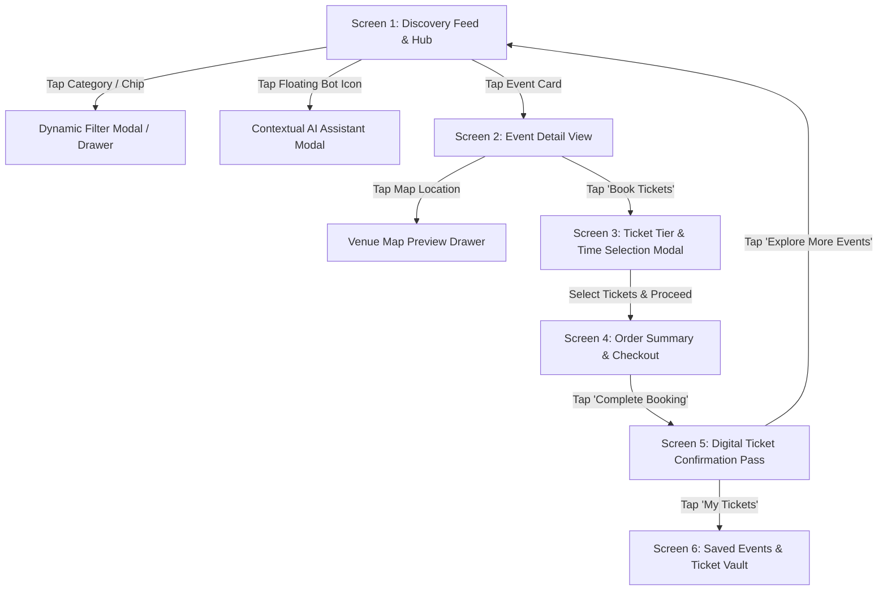

# Multi-Category Event Discovery & Booking Platform
## Comprehensive Research and UX Specification

**Project Student:** Deepti Baskar [44110145]  
**Academic Context:** Professional Training I (PT1) — Dept. of Computer Science & Engineering, Sathyabama Institute of Science and Technology  
**Mentor:** Dr. Leena Sivaguru, Associate Professor, Dept. of CSE  
**Document Type:** Senior Product Design & UX Research Specification  
**Version:** 1.0.0 (Living Baseline Specification)  

---

## 1. Executive Summary & Research Foundations

The modern consumer leisure ecosystem is heavily fragmented. Users looking to plan their week or weekend frequently juggle multiple disconnected portals to discover music concerts, stand-up comedy performances, cultural workshops, theatrical plays, and recreational sports. 

Existing market solutions typically fall into two extremes:
1. **High-Density Catalog Monopolies (e.g., BookMyShow):** Offer exhaustive regional inventory and deep filtering parameters, but suffer from high visual clutter, aggressive advertisement placement, hidden convenience fees revealed late at payment, and rigid legacy flows.
2. **Curated Niche Experiences (e.g., Fever):** Excel in sensory appeal, premium visual storytelling, and bespoke immersive productions (like Candlelight Concerts), but feature narrow catalog variety, limited filtering granularities, and lower catalog breadth for everyday local activities.
3. **Emerging Unified Experience Apps (e.g., District by Zomato):** Blend dining, movies, live concerts, and comedy with modern design system tokens, yet face challenges in balancing disparate category mental models (e.g., buying a seat at a comedy club vs. reserving a restaurant table vs. booking festival passes).

### Primary Objective
To design an intuitive, high-velocity consumer event discovery and booking interface that synthesizes the **usability and aesthetic velocity of District**, the **robust multi-parameter filtering of BookMyShow**, and the **curated emotional storytelling of Fever**, while introducing a **contextual AI Discovery Concierge** and **radical upfront pricing transparency** to eliminate user friction.

---

## 2. Evidence-Based Competitor Audit

*Methodology Note: In strict compliance with research constraints, only publicly accessible web endpoints, DOM structures, and verified layout systems were audited. Where deep mobile-app screens (e.g., authenticated payment gateways) were inaccessible via automated scrapers, observations are explicitly demarcated as empirical design patterns documented on Mobbin and Pageflows design repositories.*

### 2.1 District by Zomato (`district.in`)
* **Audited Touchpoints:** Web homepage (`/`), events portal (`/events`), and header navigation shell (`Next.js / Turbopack`).
* **Visual & Structural Observations:**
  * **Unified Top-Level Navigation:** Employs a sticky master header with an integrated location selector modal, an omni-search bar (`"Search for events, movies and restaurants"`), and category pill tabs (`For you`, `Dining`, `Movies`, `Events`, `Comedy`).
  * **Dynamic Thematic Accents:** Employs subtle pastel background tinting to differentiate domains (e.g., `#EAE5FF` soft violet for "For You", `#F9F4DC` warm ochre for "Events").
  * **Vertical Poster Ratios:** Standardized 2:3 vertical aspect ratio cards (`event_cover_image_vertical`) ensuring high visual fidelity for artist photos and festival artwork.
* **UX Strengths:**
  * Clean, modern typography with spacious touch targets.
  * Rapid contextual switching across entertainment genres.
* **Friction Points & Gaps:**
  * Multi-category filtering on secondary pages lacks instant multi-select facets (e.g., selecting both "This Saturday" AND "Under ₹1000" simultaneously without full-page re-renders).
  * Web experience acts primarily as an app-download funnel rather than a self-contained, high-speed transactional interface.

### 2.2 BookMyShow (`in.bookmyshow.com/explore/events-chennai`)
* **Audited Touchpoints:** Regional event directory, desktop filter sidebar, and mobile responsive filter drawer patterns.
* **Visual & Structural Observations:**
  * **Granular Multi-Parameter Filters:** Dedicated facet sections for Date (`Today`, `Tomorrow`, `This Weekend`, Custom Date Range), Categories (`Comedy`, `Music`, `Workshops`, `Theatre`, `Sports`, `Kids`), Language (`Tamil`, `English`, `Hindi`), and Price Tiers (`Free`, `0-500`, `501-1000`, `1001-2000`, `2000+`).
  * **Social Validation Micro-Signals:** Prominent counters displaying "Interested" metrics (e.g., "1.2k interested") and badges ("Fast Filling", "Selling Fast").
* **UX Strengths:**
  * Comprehensive filtering flexibility allows intent-driven users to quickly locate hyper-specific events (e.g., "English stand-up comedy this Saturday in Alwarpet").
* **Friction Points & Anti-Patterns:**
  * **Late Fee Disclosure (Fee Shock):** Base ticket prices are displayed on event cards, but substantial Internet Handling Fees and Integrated GST are concealed until the final checkout screen, triggering high cart abandonment.
  * **Cognitive Overload:** Pages are congested with third-party display advertisements, credit card partnership banners, and aggressive upsells (popcorn combos, event cancellation insurance).
  * **Mandatory Registration Wall:** Users cannot easily explore seat pricing breakdown without entering a mobile phone number and waiting for an OTP.

### 2.3 Fever (`feverup.com/en`)
* **Audited Touchpoints:** Live client application configuration (`WLCFG`), metadata flags, and plan-view layout schemas.
* **Visual & Structural Observations:**
  * **Curated Storytelling:** Prioritizes editorial imagery, atmospheric typography, curated badges ("Fever Original"), and user review galleries (`showUserPhotoGallery: true`).
  * **Session & Accessibility Modeling:** Detailed visual session-type icons (e.g., covered grandstand, giant screen, wheelchair accessibility) embedded directly into ticket selectors.
  * **Frictionless Guest Checkouts:** Built-in `shortLoginFlow: enabled` and `skipFreePurchase: true` allowing quick checkout initiation without requiring extensive upfront profile completion.
* **UX Strengths:**
  * Emotional engagement through high-quality photography and social proof (Trustpilot scores, verified attendee reviews).
  * High perceived product value through dark-mode aesthetic touches and immersive visual hierarchy.
* **Friction Points & Gaps:**
  * Search and filtering are secondary to curated editorial feeds; locating small-scale local community events or filtering across strict budget bands is cumbersome.
  * Heavily tailored for flagship ticketed shows (e.g., Candlelight concerts, Harry Potter exhibitions) rather than agile, multi-category daily local activities.

---

## 3. Concise Competitor Comparison Matrix

| UX & Product Dimension | District (Zomato) | BookMyShow (BMS) | Fever | **Our Proposed Platform** |
| :--- | :--- | :--- | :--- | :--- |
| **Discovery Mental Model** | Hybrid directory + App-first funnel | Massive catalog listing | Editorial curation & immersive originals | **Curated discovery feeds + contextual smart search** |
| **Filter Usability & Depth** | Basic category tabs; limited faceted query depth | Deep multi-facet filtering (Date, Language, Price, Category) | Minimalist curation tags; limited multi-parameter filters | **Sticky interactive filter bar + instant bottom-sheet faceted filters** |
| **Card Scannability** | High (clean modern posters, uncluttered text) | Medium (dense info, inconsistent badge styling, ads) | High (immersive photography, rating badges, starting prices) | **High (2:3 aspect posters, upfront "All-in" price, date pill, category chip)** |
| **Pricing Transparency** | Base price displayed on card; fees in cart | **Low:** Substantial convenience fees revealed at final checkout step | Medium: "From" pricing displayed; fees added at review | **High (Zero Fee Shock):** "All-In" upfront pricing toggle or clear fee line-item |
| **Ticket & Seat Selection** | Multi-tier modal with basic counters | Interactive SVG seat map or tiered list | Tiered list with session icons & remaining availability | **Hybrid: Visual tiered cards with perks + interactive zone/seat picker** |
| **Checkout Ergonomics** | Fast, standard digital checkout | High friction: 4–5 steps (seat -> add-ons -> login -> insurance -> pay) | Fast: 2-step modal with guest option | **Ultra-lean 2-step slide-over/bottom-sheet checkout (Summary -> Simulated Pay)** |
| **AI / Real-Time Assistance** | None on web discovery | Static FAQ chatbot in Help section | Standard support ticketing | **Floating Contextual AI Concierge for tailored discovery & FAQ resolution** |
| **Visual Design System** | Modern minimalist, light theme with pastel accents | Dense legacy layout with red brand accents | Moody dark/light theme, high-contrast lifestyle typography | **Polished dark/light hybrid, glassmorphic floating bars, modern fluid typography** |

---

## 4. Problem Definition & Target Audience

### 4.1 Core UX Problem Statement
> *"Modern event-goers experience decision paralysis and transactional fatigue because existing platforms either dump cluttered, ad-heavy catalogs with hidden fees at checkout (BookMyShow), or restrict options to high-cost curated spectacles lacking granular filters (Fever). Users require a centralized platform that allows them to discover relevant multi-category experiences in under 30 seconds, evaluate venue and pricing with total transparency, and complete ticket reservations in minimal friction-free steps."*

### 4.2 Target Audience Personas

#### Persona 1: The Spontaneous Socialite (Weekend Planner)
* **Demographics:** Age 20–28; college student or young professional; mobile-first.
* **Scenario:** It is Friday 4:00 PM; looking for comedy gigs, acoustic sessions, or food pop-ups for Saturday evening with friends.
* **Pain Points:** Wants to filter by "This Weekend" + "Under ₹600" without browsing 50 irrelevant theatre plays; hates surprise convenience fees that double group booking costs.
* **Key Need:** Instant "Happening This Weekend" feed, rapid date/price chips, and 1-tap shareable booking summaries.

#### Persona 2: The Intent-Driven Enthusiast (Concert & Sports Seeker)
* **Demographics:** Age 24–40; tech-savvy; plans 2–6 weeks ahead.
* **Scenario:** Tracking a touring indie band or an upcoming football match; cares intensely about seat location, stage view, and tier inclusions (VIP vs GA).
* **Pain Points:** Unclear stage layout diagrams on mobile; lengthy multi-step checkouts that time out during high-demand sales.
* **Key Need:** Clear visual tier breakdown with perk comparison (e.g., "Early Entry + Free Beverage"), dynamic seat zone map, and countdown reservation timers.

#### Persona 3: The Experiential Learner (Workshop & Community Explorer)
* **Demographics:** Age 22–35; interested in pottery, art therapy, coffee tasting, and creative masterclasses.
* **Scenario:** Looking for solo or couple activities on Sunday mornings; needs to know prerequisites, materials provided, instructor profile, and exact venue accessibility.
* **Pain Points:** Lack of granular information on workshop agendas; difficult to ask quick questions before committing to a ticket.
* **Key Need:** Embedded instructor bios, venue amenity pills (Wheelchair friendly, AC, Materials included), and the **AI Chatbot** to ask "Is this workshop beginner-friendly?".

---

## 5. Five Core UX Design Principles

1. **Radical Price & Availability Transparency (No Hidden Surprises)**
   * *Guideline:* The price displayed on the discovery card must equal the final payable amount, or explicitly disclose mandatory taxes/fees via an instant tooltip. Seat availability and scarcity badges ("Only 4 tickets left at this price") must reflect genuine real-time state, preventing cart expiration frustration.
2. **Progressive Disclosure & Cognitive Ergonomics (Zero Decision Fatigue)**
   * *Guideline:* Follow Hick's Law and Miller's Law. Present only the most critical decision-making criteria upfront on cards (Visual poster, Event Title, Date & Time, Neighborhood Venue, Starting Price). Secondary details (artist bio, refund policies, FAQs, full parking info) expand smoothly upon user demand without disorienting navigation jumps.
3. **Curated Serendipity with Contextual Assistance (Smart, Not Pushy)**
   * *Guideline:* Users shouldn't be forced to think in search keywords. Provide curated lifestyle collections ("Vibe with Jazz", "Laugh Out Loud", "Handmade & Craft") alongside an always-accessible **AI Discovery Concierge** that accepts natural language queries (e.g., *"Find a chilled workshop this Sunday morning near Anna Nagar"*).
4. **Thumb-Zone Velocity & Ergonomic Touch (Fitts's Law)**
   * *Guideline:* Core interactive targets (filter triggers, date selectors, "Book Now" CTAs, counter steppers) must sit comfortably within the natural mobile thumb zone (bottom 40% of the viewport) with minimum touch targets of 44×44pt (Apple HIG) / 48×48dp (Material Design 3).
5. **Calm Confidence & Continuous System Status (Nielsen Norman Heuristic #1)**
   * *Guideline:* Every state transition—from applying a filter chip to selecting ticket quantities and reserving an order—must provide immediate visual micro-feedback (haptic or animated confirmation, dynamic subtotal calculation, lock timer pill, clear confirmation pass with QR generation).

---

## 6. Measurable Success Criteria

| Metric | Target Goal | Measurement Protocol |
| :--- | :--- | :--- |
| **Time-to-Discovery (TTD)** | < 30 seconds | Median time from landing on app to opening an event detail screen matching user intent. |
| **Task Completion Rate (TCR)** | > 92% | Percentage of test participants successfully discovering an event and completing a simulated booking. |
| **Time-to-Booking (TTB)** | < 90 seconds | Total elapsed time from event card click to ticket confirmation screen. |
| **Fee-Shock Abandonment** | < 5% | Drop-off rate at the order summary / payment initiation step due to unanticipated costs. |
| **System Usability Scale (SUS)** | Score ≥ 82 / 100 | Post-test standard 10-item usability survey indicating "Excellent / Grade A" usability. |
| **Filter Efficiency** | ≤ 2 taps | Number of interactions needed to narrow feed to a desired category + timeframe (e.g. Comedy + This Weekend). |

---

## 7. Prioritized MVP Scope (MoSCoW Framework)

### 7.1 Must Have (Smallest Feature Set for an Excellent End-to-End Booking Flow)
* **M1: Omni-Discovery Hub:**
  * Clean category navigation pills: `All`, `Music & Concerts`, `Stand-Up Comedy`, `Workshops`, `Sports & Fitness`.
  * Visual Hero Spotlight: Dynamic carousel highlighting 3–4 premier weekend events with tags ("Curated", "Filling Fast").
  * Curated Discovery Rails: "Trending This Week", "Weekend Escapes", "Budget Picks (Under ₹499)".
* **M2: Instant Interactive Filter Bar & Drawer:**
  * Quick-access chips: `Date` (Today, Tomorrow, Weekend), `Price Range` slider/presets, `Category`, `Venue Location`.
  * Live result count badge ("Show 14 Events") with immediate, zero-reload feed updates.
* **M3: High-Scannability Event Card System:**
  * 2:3 ratio vertical posters with category pill, title, date/time badge, venue neighborhood, and upfront starting price.
  * Bookmark/Favorite toggle for quick saving.
* **M4: Comprehensive Event Detail View:**
  * Atmospheric hero banner with back navigation and bookmark actions.
  * Key detail strip: Date & Time, Duration, Venue & Neighborhood address with interactive "Open Map" preview.
  * Lineup / Artist profile cards with photo and genre tag.
  * "What to Expect" highlight bullets and essential venue rules (Age limit, Parking, Wheelchair access).
  * Sticky bottom action bar with price per person and prominent "Book Tickets" CTA.
* **M5: Dynamic Ticket Tier & Session Selector:**
  * Clean session / time-slot picker (e.g., `4:00 PM - 6:00 PM`, `7:30 PM - 9:30 PM`).
  * Tiered cards (e.g., `Silver Tier`, `Gold Tier`, `VIP Backstage`) showing price, perks list, and real-time availability indicator.
  * Quantity incrementer (`-` / `+`) with auto-updating bottom subtotal bar.
* **M6: Ultra-Lean 2-Step Order Summary & Simulated Checkout:**
  * Order Summary card with selected event, date, time slot, and ticket count.
  * 100% Transparent Fee Breakdown: Base Ticket Price + Platform Fee (with explicit waiver/discount banner) + GST = Total Payable.
  * Simulated Payment selector: One-click simulated payment options (UPI / GPay, Credit/Debit Card, Apple Pay).
  * 10-minute ticket reservation countdown timer to prevent ghost bookings.
* **M7: Digital Ticket Confirmation & Wallet Sync:**
  * Instant post-purchase celebration view with generated QR entry pass.
  * Booking ID, attendee details, and venue address.
  * Action triggers: "Add to Calendar (.ics)", "Download PDF Pass", "Get Venue Directions".
* **M8: Contextual AI Discovery Concierge ("EventBot"):**
  * Floating persistent assistant trigger in the navigation/bottom corner.
  * Pre-configured quick prompt chips: *"Cheap comedy shows this Friday"*, *"Best workshops for couples"*, *"Family-friendly outdoor events"*.
  * Interactive conversational recommendations linking directly into event detail views.

### 7.2 Should Have (High-Impact Secondary Enhancements)
* **S1: Interactive Seat Map Visualizer:** Simplified SVG-based seat selection for auditorium/seated comedy shows.
* **S2: Social Proof & Attendee Photo Wall:** Verified attendee ratings with photo upload highlights (Fever-inspired).
* **S3: Dark/Light Mode Theme Toggle:** User-switchable high-contrast color themes compliant with WCAG AAA contrast.

### 7.3 Could Have (Post-MVP Candidates)
* **C1: Group Split-Pay Links:** Shareable reservation link allowing friends to pay their share within 15 minutes.
* **C2: Spotify / Apple Music Artist Sync:** Auto-recommending concerts based on user listening history.

### 7.4 Won't Have (Explicit Out-of-Scope Constraints)
* Real production payment gateway integrations (Razorpay/Stripe live transactions).
* Real-world SMS/OTP telecom infrastructure (simulated guest auth with email/name handles will be used).
* Complex backend microservices or distributed database systems.

---

## 8. Screen Inventory & Architecture

### Detailed Screen Specifications:

1. **SCR-01: Discovery & Feed Hub (Homepage)**
   * **Header Component:** Location Selector (`Chennai, IN`), App Logo, AI Assistant quick-launch pill, and Saved Items heart badge.
   * **Category Pill Bar:** Horizontally scrollable chips with active state markers (`All`, `Concerts`, `Comedy`, `Workshops`, `Sports`).
   * **Curated Hero Banner:** Auto-sliding high-contrast banner with event title, date tag, and direct "Book" button.
   * **Quick Filter Bar:** `When (Today/Tomorrow/Weekend)`, `Budget (< ₹500)`, `Filters (All)`.
   * **Event Grids & Rails:** Modular 2-column or 3-column responsive card layouts with clear pricing and availability badges.

2. **SCR-02: Faceted Filter & Search Modal (Bottom Sheet / Drawer)**
   * **Date Selector:** Multi-segment switch (`Anytime`, `Today`, `Tomorrow`, `This Weekend`, `Custom Date`).
   * **Price Range:** Interactive slider with dual handles (₹0 to ₹5,000+) and preset quick-pills (`Free`, `< ₹500`, `₹500 - ₹1,500`).
   * **Category Multi-Select:** Toggle chips with icons for genres and formats (Indoor, Outdoor).
   * **Footer CTA:** Sticky bar with "Reset All" and "Show [X] Events" primary button.

3. **SCR-03: Event Detail Screen**
   * **Media Carousel / Cover:** Immersive visual header with back button, share sheet, and bookmark icon.
   * **Summary Header:** Event Title, Category Badge, Rating & Attendee Count, Date & Time block, Venue with distance indicator.
   * **Content Sections:** "About Experience", "Artist / Host Lineup", "Highlights & Amenities", "Venue Location with Map Snippet", "Terms & Cancellation".
   * **Sticky Booking Bar:** Left: Starting price with "Taxes included" label; Right: "Select Tickets" prominent CTA.

4. **SCR-04: Ticket Tier & Session Selector (Interactive Modal / Sheet)**
   * **Session / Time-Slot Picker:** Horizontal pill selector showing start times and remaining seat indicators.
   * **Tier List:** Vertical cards for Silver, Gold, and VIP Passes with itemized perks bullet points.
   * **Stepper Controls:** Accessible `+` / `-` stepper buttons with max limit constraint (e.g. max 10 tickets).
   * **Live Subtotal Bar:** Displays total ticket count and combined cost with instant "Proceed to Checkout" action.

5. **SCR-05: Order Summary & Lean Checkout**
   * **Reservation Countdown Pill:** "Tickets reserved for 09:59 minutes".
   * **Booking Overview Card:** Event thumbnail, title, venue, selected time, and ticket breakdown.
   * **Attendee Contact Form (Minimalist):** Name and Email address (with 1-click auto-fill for testing).
   * **Transparent Price Itemization:** Subtotal + Transparent Booking Fee (with "Promo Discount Applied" pill) + 18% GST = Final Total.
   * **Simulated Payment Triggers:** One-tap mock payment buttons (`Simulate UPI Pay`, `Simulate Apple/Google Pay`, `Card`).

6. **SCR-06: Digital Ticket Confirmation Pass (Post-Booking Vault)**
   * **Success Animation:** High-confidence checkmark animation with haptic reassurance.
   * **Boarding-Pass Style Ticket Card:** High-resolution dynamic QR code, Booking Reference Code, Event Name, Date, Seat/Tier details, Venue address.
   * **Utility Actions:** "Add to Apple/Google Wallet", "Sync with Google Calendar", "Get Directions via Maps", "Share Ticket Pass".

7. **SCR-07: Contextual AI Discovery Assistant (Floating Drawer)**
   * **Header:** "Event Concierge AI" with status pill ("Online & Ready").
   * **Chat Feed:** Conversational bubble history offering personalized suggestions.
   * **Interactive Recommendation Cards:** Embedded mini event cards inside chat bubbles with instant "View Event" buttons.
   * **Quick Prompt Chips:** One-tap queries to accelerate user inquiry without typing.

---

## 9. Assumptions Requiring User Validation

| Assumption ID | Hypothesis / User Assumption | Potential Risk if False | Validation Experiment / Metric |
| :--- | :--- | :--- | :--- |
| **ASM-01: Upfront Pricing** | Users strongly prefer seeing total all-in price on cards rather than lower "base" ticket prices. | Card prices might initially look higher than competitors (e.g. ₹590 vs ₹500 + fees), potentially lowering initial card click-through rate. | **A/B Test:** Measure Click-Through-Rate (CTR) vs. Final Conversion on cards with "From ₹500 (+₹90 fees)" vs. "₹590 (All-in)". |
| **ASM-02: AI Assistant Adoption** | Mainstream users will utilize a conversational AI chatbot to discover events rather than standard filter menus. | Users may ignore the floating chatbot or perceive it as an annoying customer support bot. | **Telemetry Tracking:** Measure AI Concierge activation rate and search conversion rate vs. traditional filter drawer usage. |
| **ASM-03: Guest Checkout Preference** | Eliminating mandatory mobile OTP login before ticket selection increases checkout completion velocity. | Risk of unverified booking data or difficulty recovering tickets if user enters a typo in email. | **Funnel Drop-off Analysis:** Measure drop-off at attendee details screen with instant email validation vs. phone OTP. |
| **ASM-04: Filter Density Tolerance** | Event seekers want simple high-level chips (When, Category, Budget) on the feed and only open complex filters when necessary. | Advanced users looking for hyper-niche genres (e.g. "Tamil non-verbal mime theatre") might find high-level chips insufficient. | **Qualitative Task Observation:** Track time taken to find specialized events and frequency of opening the advanced filter drawer. |
| **ASM-05: Single-Screen Ticket Selection** | Combining time-slot selection and tier quantity stepper into a single cohesive bottom sheet reduces cognitive friction compared to multi-screen wizards. | The sheet could feel visually crowded on smaller mobile viewports (e.g. iPhone SE / 375px width). | **Responsive Usability Testing:** Test on both 375px and 430px viewports; observe scroll behavior and tap accuracy. |

---

## 10. Design System & Aesthetic Foundation

In accordance with Apple HIG, Material Design 3, and modern dark-mode aesthetic standards:

* **Color Palette (Dark Elegance & Vibrant Accents):**
  * `Background Primary`: `#0B0E14` (Deep obsidian slate)
  * `Surface Elevated / Glass`: `rgba(22, 27, 34, 0.75)` with `backdrop-filter: blur(16px)` and `border: 1px solid rgba(255, 255, 255, 0.08)`
  * `Brand Accent (Electric Indigo)`: `#6366F1` / `#4F46E5` (High-contrast primary interactive trigger)
  * `Secondary Accent (Vibrant Coral/Amber)`: `#F43F5E` / `#F59E0B` (For urgency badges and category highlights)
  * `Text Primary`: `#F8FAFC` (High legibility contrast ratio > 12:1)
  * `Text Muted / Subtitle`: `#94A3B8` (4.5:1 WCAG AA compliant)
  * `Success Green`: `#10B981` (For confirmation passes and confirmed availability)
* **Typography Hierarchy (Google Fonts: Outfit / Inter):**
  * `Display Title`: 28px–32px, SemiBold / Bold, -0.02em tracking
  * `Headline / Section`: 20px–22px, SemiBold
  * `Card Title`: 16px–18px, Medium
  * `Body Text`: 14px–15px, Regular, 1.5 line height
  * `Caption / Micro-tag`: 11px–12px, SemiBold, 0.04em uppercase tracking
* **Touch Targets & Spacing:**
  * Minimum button height: 48px
  * Card corner radii: 16px–20px for container elegance
  * Interactive transitions: 200ms–250ms cubic-bezier(0.16, 1, 0.3, 1) ease-out motion.

---

## 11. Next Implementation Phases

1. **Phase 1 (Complete):** Literature Review & Competitor UX Audit, Baseline Specification, Prioritized MVP Definition.
2. **Phase 2 (Design System & Interactive Prototype):** Develop the component library, responsive HTML5/CSS3/Vanilla JS interactive prototype modeling the complete end-to-end journey from discovery to confirmation.
3. **Phase 3 (Usability Testing & Iteration):** Execute structured usability test scenarios across target personas to validate the 5 core assumptions and optimize task completion times.
